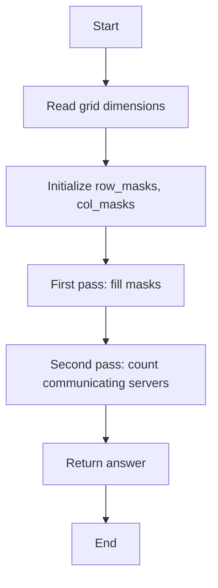

<h2><a href="https://leetcode.com/problems/count-servers-that-communicate">1267. Count Servers that Communicate</a></h2>

<p>You are given a map of a server center, represented as a <code>m * n</code> integer matrix&nbsp;<code>grid</code>, where 1 means that on that cell there is a server and 0 means that it is no server. Two servers are said to communicate if they are on the same row or on the same column.<br>
<br>
Return the number of servers&nbsp;that communicate with any other server.</p>

<p>&nbsp;</p>
<p><span class="float-right -my-0.5 ml-2 inline-flex select-none items-center" data-example-lang-controls=""><span role="group" class="inline-flex h-6 items-center rounded-sd-md bg-sd-muted p-0.5" data-example-lang-toggle=""><button type="button" aria-pressed="true" class="h-5 max-w-[10rem] truncate whitespace-nowrap rounded-sd-sm border px-2 text-xs font-normal leading-none border-sd-border bg-sd-background text-sd-foreground">Original</button><button type="button" aria-pressed="false" class="h-5 max-w-[10rem] truncate whitespace-nowrap rounded-sd-sm border px-2 text-xs font-normal leading-none border-transparent text-sd-muted-foreground hover:text-sd-foreground">Java</button></span></span><strong class="example">Example 1:</strong></p>

<p></p>

<pre><strong>Input:</strong> grid = [[1,0],[0,1]]
<strong>Output:</strong> 0
<b>Explanation:</b>&nbsp;No servers can communicate with others.</pre>

<p><strong class="example">Example 2:</strong></p>

<p><strong></strong></p>

<pre><strong>Input:</strong> grid = [[1,0],[1,1]]
<strong>Output:</strong> 3
<b>Explanation:</b>&nbsp;All three servers can communicate with at least one other server.
</pre>

<p><strong class="example">Example 3:</strong></p>

<p></p>

<pre><strong>Input:</strong> grid = [[1,1,0,0],[0,0,1,0],[0,0,1,0],[0,0,0,1]]
<strong>Output:</strong> 4
<b>Explanation:</b>&nbsp;The two servers in the first row can communicate with each other. The two servers in the third column can communicate with each other. The server at right bottom corner can't communicate with any other server.
</pre>

<p>&nbsp;</p>
<p><strong>Constraints:</strong></p>

<ul>
	<li><code>m == grid.length</code></li>
	<li><code>n == grid[i].length</code></li>
	<li><code>1 &lt;= m &lt;= 250</code></li>
	<li><code>1 &lt;= n &lt;= 250</code></li>
	<li><code>grid[i][j] == 0 or 1</code></li>
</ul>


---

# 🛍️ Count-Servers-that-Communicate | Explained

## Approach 1: Bit‑Mask Row/Column Counting
### Intuition
Imagine a data‑center floor plan represented as a grid where each cell either contains a server (`1`) or is empty (`0`). A server can “talk” to any other server that shares its **row** or **column**.  
If we could quickly know, for every row, *which columns* contain servers, and for every column, *which rows* contain servers, we could decide for each individual server whether it has at least one neighbour.  
A compact way to store “which positions are occupied” is a **bit mask**: each bit represents a column (for a row mask) or a row (for a column mask). Setting a bit to `1` means “there is a server there”. With a mask we can test “is there more than one server in this line?” by checking whether the mask has at least two set bits – a classic trick is `mask & (mask‑1)` which clears the least‑significant set bit; the result is non‑zero iff at least two bits were originally set.

### Algorithm Visualized


### Approach
1. **Dimension extraction** – store number of rows (`R`) and columns (`C`).  
2. **Mask containers** – create two lists:
   * `row_masks[R]` – each entry will become a bitmask of columns that contain a server in that row.
   * `col_masks[C]` – each entry will become a bitmask of rows that contain a server in that column.
3. **First traversal (populate masks)**  
   * For each cell `(r, c)`, if `grid[r][c] == 1`:
     * Set the `c`‑th bit in `row_masks[r]`.
     * Set the `r`‑th bit in `col_masks[c]`.
4. **Second traversal (determine communicators)**  
   * For each cell `(r, c)` that contains a server:
     * `row_masks[r] & (row_masks[r] - 1)` clears the lowest set bit; a non‑zero result means the row has **≥ 2** servers.
     * `col_masks[c] & (col_masks[c] - 1)` does the same for the column.
     * If either expression is non‑zero, the server can communicate → increment answer.
5. **Return** the accumulated count.

### Detailed Code Analysis
```python
class Solution:
    def countServers(self, grid: list[list[int]]) -> int:
        rows, cols = len(grid), len(grid[0])          # 1️⃣ grid dimensions
        row_masks = [0] * rows                       # 2️⃣ one mask per row, init to 0
        col_masks = [0] * cols                       # 2️⃣ one mask per column, init to 0

        # 3️⃣ First pass – build bit‑mask representation
        for row in range(rows):
            for col in range(cols):
                if grid[row][col]:                   # cell holds a server?
                    row_masks[row] |= (1 << col)     # set column‑bit in row mask
                    col_masks[col] |= (1 << row)     # set row‑bit in column mask

        ans = 0                                       # 4️⃣ accumulator for result
        # 4️⃣ Second pass – evaluate each server
        for row in range(rows):
            for col in range(cols):
                if grid[row][col]:                   # only consider actual servers
                    # Does this row have another server?
                    row_connected = row_masks[row] & (row_masks[row] - 1)
                    # Does this column have another server?
                    col_connected = col_masks[col] & (col_masks[col] - 1)
                    # If either line has ≥2 servers, this one can talk
                    if row_connected or col_connected:
                        ans += 1

        return ans                                    # 5️⃣ final answer
```

* **Line 1‑2**: `rows, cols` store dimensions; `row_masks` and `col_masks` are pre‑allocated integer arrays, each entry initially `0` (no bits set).  
* **Lines 5‑9** (first nested loop):  
  * `if grid[row][col]` checks for a server.  
  * `row_masks[row] |= (1 << col)` uses a left‑shift to create a bit with a `1` at position `col` and OR‑s it into the existing mask, thereby remembering that column `col` is occupied in this row.  
  * Symmetrically, `col_masks[col] |= (1 << row)` records that row `row` is occupied in column `col`.  
  * After the loop, each mask is a compact representation of all occupied positions in that line.  
* **Lines 11‑12**: initialise answer counter.  
* **Lines 13‑20** (second nested loop):  
  * Again filter to actual servers.  
  * `row_masks[row] & (row_masks[row] - 1)` – classic “remove lowest set bit” trick. If the row mask had only a single `1` (meaning the current server is the sole server in its row), the expression yields `0`. Any additional server makes it non‑zero, signalling row‑communication possible.  
  * Same logic for the column mask.  
  * `if row_connected or col_connected:` – if either line holds another server, the current server contributes to the final count.  
  * `ans += 1` increments the total.  
* **Line 22** returns the total count of servers that can communicate.

### Code
```python
class Solution:
    def countServers(self, grid: list[list[int]]) -> int:
        rows, cols = len(grid), len(grid[0])
        row_masks = [0] * rows
        col_masks = [0] * cols
        for row in range(rows):
            for col in range(cols):
                if grid[row][col]:
                    row_masks[row] |= (1 << col)
                    col_masks[col] |= (1 << row)
        ans = 0
        for row in range(rows):
            for col in range(cols):
                if grid[row][col]:
                    row_connected = row_masks[row] & (row_masks[row] - 1)
                    col_connected = col_masks[col] & (col_masks[col] - 1)
                    if row_connected or col_connected:
                        ans += 1
        return ans
```

### Complexity
- **Time:**  
  * First pass visits every cell once → `O(R * C)`.  
  * Second pass also visits every cell once → another `O(R * C)`.  
  * Total `O(R * C)` where `R` = number of rows, `C` = number of columns.

- **Space:**  
  * `row_masks` stores `R` integers, `col_masks` stores `C` integers → `O(R + C)` extra space.  
  * No additional structures proportional to the total number of cells are allocated.

## 🕵️‍♂️ Follow‑up Questions (Optional)

1. **Could we solve the problem without bit‑masks?**  
   Yes. A straightforward alternative is to count servers per row and per column using two integer arrays, then a second pass adds a server to the answer if its row count > 1 or column count > 1. The bit‑mask version is just a compact representation; both have the same `O(R*C)` time and `O(R+C)` space.

2. **What happens if the grid is very large (e.g., 10⁴ × 10⁴)?**  
   The mask approach relies on Python integers that can grow arbitrarily, but shifting by tens of thousands of bits creates huge integers, increasing constant factors and memory usage. In such extreme cases, the plain counting‑array method is preferable because it stores small integers instead of massive bit vectors.