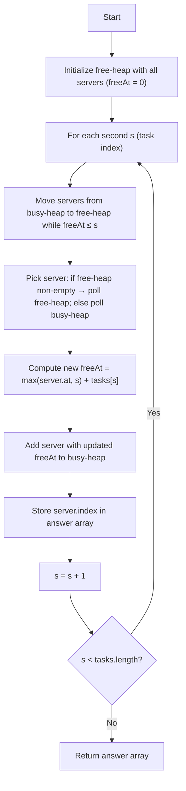

<h2><a href="https://leetcode.com/problems/process-tasks-using-servers">1882. Process Tasks Using Servers</a></h2>

<p>You are given two <strong>0-indexed</strong> integer arrays <code>servers</code> and <code>tasks</code> of lengths <code>n</code>​​​​​​ and <code>m</code>​​​​​​ respectively. <code>servers[i]</code> is the <strong>weight</strong> of the <code>i<sup>​​​​​​th</sup></code>​​​​ server, and <code>tasks[j]</code> is the <strong>time needed</strong> to process the <code>j<sup>​​​​​​th</sup></code>​​​​ task <strong>in seconds</strong>.</p>

<p>Tasks are assigned to the servers using a <strong>task queue</strong>. Initially, all servers are free, and the queue is <strong>empty</strong>.</p>

<p>At second <code>j</code>, the <code>j<sup>th</sup></code> task is <strong>inserted</strong> into the queue (starting with the <code>0<sup>th</sup></code> task being inserted at second <code>0</code>). As long as there are free servers and the queue is not empty, the task in the front of the queue will be assigned to a free server with the <strong>smallest weight</strong>, and in case of a tie, it is assigned to a free server with the <strong>smallest index</strong>.</p>

<p>If there are no free servers and the queue is not empty, we wait until a server becomes free and immediately assign the next task. If multiple servers become free at the same time, then multiple tasks from the queue will be assigned <strong>in order of insertion</strong> following the weight and index priorities above.</p>

<p>A server that is assigned task <code>j</code> at second <code>t</code> will be free again at second <code>t + tasks[j]</code>.</p>

<p>Build an array <code>ans</code>​​​​ of length <code>m</code>, where <code>ans[j]</code> is the <strong>index</strong> of the server the <code>j<sup>​​​​​​th</sup></code> task will be assigned to.</p>

<p>Return <em>the array </em><code>ans</code>​​​​.</p>

<p>&nbsp;</p>
<p><span class="float-right -my-0.5 ml-2 inline-flex select-none items-center" data-example-lang-controls=""><span role="group" class="inline-flex h-6 items-center rounded-sd-md bg-sd-muted p-0.5" data-example-lang-toggle=""><button type="button" aria-pressed="true" class="h-5 max-w-[10rem] truncate whitespace-nowrap rounded-sd-sm border px-2 text-xs font-normal leading-none border-sd-border bg-sd-background text-sd-foreground">Original</button><button type="button" aria-pressed="false" class="h-5 max-w-[10rem] truncate whitespace-nowrap rounded-sd-sm border px-2 text-xs font-normal leading-none border-transparent text-sd-muted-foreground hover:text-sd-foreground">Java</button></span></span><strong class="example">Example 1:</strong></p>

<pre><strong>Input:</strong> servers = [3,3,2], tasks = [1,2,3,2,1,2]
<strong>Output:</strong> [2,2,0,2,1,2]
<strong>Explanation: </strong>Events in chronological order go as follows:
- At second 0, task 0 is added and processed using server 2 until second 1.
- At second 1, server 2 becomes free. Task 1 is added and processed using server 2 until second 3.
- At second 2, task 2 is added and processed using server 0 until second 5.
- At second 3, server 2 becomes free. Task 3 is added and processed using server 2 until second 5.
- At second 4, task 4 is added and processed using server 1 until second 5.
- At second 5, all servers become free. Task 5 is added and processed using server 2 until second 7.</pre>

<p><strong class="example">Example 2:</strong></p>

<pre><strong>Input:</strong> servers = [5,1,4,3,2], tasks = [2,1,2,4,5,2,1]
<strong>Output:</strong> [1,4,1,4,1,3,2]
<strong>Explanation: </strong>Events in chronological order go as follows: 
- At second 0, task 0 is added and processed using server 1 until second 2.
- At second 1, task 1 is added and processed using server 4 until second 2.
- At second 2, servers 1 and 4 become free. Task 2 is added and processed using server 1 until second 4. 
- At second 3, task 3 is added and processed using server 4 until second 7.
- At second 4, server 1 becomes free. Task 4 is added and processed using server 1 until second 9. 
- At second 5, task 5 is added and processed using server 3 until second 7.
- At second 6, task 6 is added and processed using server 2 until second 7.
</pre>

<p>&nbsp;</p>
<p><strong>Constraints:</strong></p>

<ul>
	<li><code>servers.length == n</code></li>
	<li><code>tasks.length == m</code></li>
	<li><code>1 &lt;= n, m &lt;= 2 * 10<sup>5</sup></code></li>
	<li><code>1 &lt;= servers[i], tasks[j] &lt;= 2 * 10<sup>5</sup></code></li>
</ul>


---

# 🛍️ Process-Tasks-Using-Servers | Explained

## Approach 1: Greedy Scheduling with Dual Priority Queues  

### Intuition  
Imagine a pool of servers each with a “weight” (think of it as a cost or speed) and an index that breaks ties.  
Every second a new task arrives. If any server is idle at that second, we give the task to the **lightest** idle server (lowest weight, then lowest index).  
If all servers are busy, we wait until the **earliest‑finishing** server becomes free; that server then takes the pending task.  

The problem reduces to continuously knowing:

1. Which idle servers are the best candidates? → a **min‑heap** sorted by `(weight, index)`.  
2. Which busy servers will finish soonest? → another **min‑heap** sorted by `(free‑time, weight, index)`.

By moving servers from the *busy* heap to the *free* heap exactly when their `free‑time` ≤ current second, we always have the correct view of the system.

### Algorithm Visualized  



### Approach  
1. **Data structures**  
   * `Server` record stores three fields: `at` (the second the server becomes free), `weight`, and `index`.  
   * `Comparator<Server> order` orders servers first by `at`, then by `weight`, then by `index`.  
   * `free` – a priority queue of idle servers (all have `at == 0`).  
   * `busy` – a priority queue of servers currently processing a task.  

2. **Initialization** (`line 9`)  
   * Insert every server into `free` with `at = 0`. This reflects that all servers are idle at time 0.  

3. **Main loop** (`lines 12‑19`) iterates over each task index `s` (the second the task arrives).  

   * **Release completed work** (`line 13‑14`)  
     * While the earliest finishing busy server (`busy.peek()`) has `at ≤ s`, it has already completed its previous task.  
     * Remove it from `busy` and re‑insert it into `free` with `at = 0` (via `freeAt(0)`).  

   * **Select a server** (`line 15`)  
     * If `free` is non‑empty, the best idle server is taken (`free.poll()`).  
     * If `free` is empty, all servers are busy; we must wait for the earliest finishing one.  
       The expression `(free.isEmpty() ? busy : free).poll()` returns the appropriate server.  

   * **Schedule the task** (`line 16`)  
     * The chosen server may already be busy (its `at` could be > `s`).  
     * The task actually starts at `max(server.at, s)`.  
     * Its processing time is `tasks[s]`, so the server will be free again at  
       `max(server.at, s) + tasks[s]`.  
     * `server.freeAt(...)` creates a new `Server` instance with the updated `at`.  
     * The new instance is placed into `busy`.  

   * **Record the assignment** (`line 17`)  
     * Store the server’s original `index` into the answer array at position `s`.  

4. **Return** (`line 20`) the filled answer array.

### Detailed Code Analysis  

| Line(s) | Code | Explanation |
|--------|------|-------------|
| 2‑4 | `record Server(long at, int weight, int index) { Server freeAt(long second) { return new Server(second, weight, index); } }` | Defines an immutable data holder (`record`) for a server. `at` is the time when the server becomes free. The helper `freeAt` creates a copy with a new `at` while preserving `weight` and `index`. |
| 6‑7 | `Comparator<Server> order = Comparator.comparingLong(Server::at).thenComparingInt(Server::weight).thenComparingInt(Server::index);` | Builds a comparator that first compares by `at` (earliest free time), then by `weight`, then by `index`. This ordering works for both `free` (where `at` is always 0) and `busy` (where `at` matters). |
| 8 | `PriorityQueue<Server> free = new PriorityQueue<>(order), busy = new PriorityQueue<>(order);` | Instantiates two min‑heaps using the same comparator. `free` holds idle servers; `busy` holds servers currently processing tasks. |
| 9 | `for (int i = 0; i < servers.length; i++) free.add(new Server(0, servers[i], i));` | Populates `free` with all servers. `at = 0` signals they are ready at time 0. `servers[i]` is the weight, `i` is the original index. |
| 11 | `int[] ans = new int[tasks.length];` | Pre‑allocates the result array. |
| 12‑19 | `for (int s = 0; s < tasks.length; s++) { … }` | Main simulation loop; `s` doubles as the current second and the task index. |
| 13‑14 | `while (!busy.isEmpty() && busy.peek().at() <= s) free.add(busy.poll().freeAt(0));` | Repeatedly extracts the earliest‑finishing busy server while its `at` is ≤ current second, converting it back to an idle server (`at = 0`). |
| 15 | `Server server = (free.isEmpty() ? busy : free).poll();` | Picks the next server: if any idle server exists, use the best idle one; otherwise, take the server that will finish first (the head of `busy`). |
| 16 | `busy.add(server.freeAt(Math.max(server.at(), s) + tasks[s]));` | Calculates the time when this server will become free again: start time = `max(server.at, s)` (if the server is still busy, we wait; otherwise we start now). Add the task duration. Push the updated server into `busy`. |
| 17 | `ans[s] = server.index();` | Record which server handled task `s`. |
| 20 | `return ans;` | Return the completed assignment list. |

### Code  

```java
class Solution {
    record Server(long at, int weight, int index) {  // at: the second it frees up; 0 while free, so free servers sort by weight, then index
        Server freeAt(long second) { return new Server(second, weight, index); }
    }

    public int[] assignTasks(int[] servers, int[] tasks) {
        Comparator<Server> order = Comparator.comparingLong(Server::at)
                                              .thenComparingInt(Server::weight)
                                              .thenComparingInt(Server::index);
        PriorityQueue<Server> free = new PriorityQueue<>(order), busy = new PriorityQueue<>(order);
        for (int i = 0; i < servers.length; i++) free.add(new Server(0, servers[i], i));

        int[] ans = new int[tasks.length];
        for (int s = 0; s < tasks.length; s++) {
            while (!busy.isEmpty() && busy.peek().at() <= s)  // done by second s
                free.add(busy.poll().freeAt(0));
            Server server = (free.isEmpty() ? busy : free).poll();  // none free: the first to finish takes it
            busy.add(server.freeAt(Math.max(server.at(), s) + tasks[s]));
            ans[s] = server.index();
        }

        return ans;
    }
}
```

### Complexity  
- **Time:**  
  * Each server is inserted into a heap at most twice per task (once into `free`, once into `busy`).  
  * Heap operations (`add`, `poll`, `peek`) cost `O(log n)` where `n = servers.length`.  
  * The outer loop runs `tasks.length` times, and the inner `while` loop processes each server at most once per task overall.  
  * Overall time: **O((m + n) log n)**, where `m = tasks.length` and `n = servers.length`. In the worst case `m` dominates, giving **O(m log n)**.  

- **Space:**  
  * Two priority queues together hold at most `n` `Server` objects.  
  * The answer array holds `m` integers.  
  * Hence **O(n + m)** auxiliary space (excluding input arrays).  

## 🕵️‍♂️ Follow-up Questions (Optional)

1. **What if multiple tasks arrive at the same second?**  
   * The current problem guarantees exactly one task per second, but the algorithm can be extended by processing a queue of pending tasks whenever a server becomes free, always selecting the lightest idle server first.

2. **Can we avoid recreating `Server` objects on every assignment?**  
   * Yes. Instead of immutable `record`, we could store mutable objects and simply update their `at` field. The heap would need a `remove`/`re‑insert` or a custom comparator that reacts to field changes, but the overall complexity stays the same.